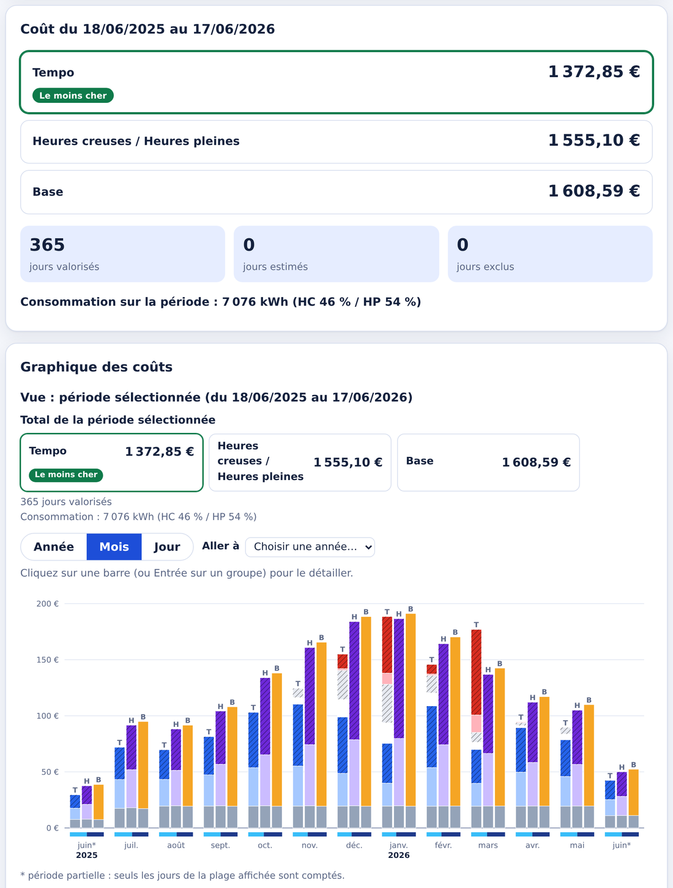

<p align="center">
  
</p>

<h1 align="center">TempoSimulateur</h1>

<p align="center">
  <strong>Tempo, Heures Creuses ou Base ?<br>Simulez votre facture EDF en quelques secondes</strong>
</p>

<p align="center">
  <a href="https://vect0r-vicall.github.io/TempoSimulateur/"></a>
</p>

<p align="center">
  <a href="LICENSE"></a>
  <a href="https://github.com/vect0r-vicall/TempoSimulateur/actions/workflows/pages.yml"></a>
  
  
</p>

<p align="center">
  <picture>
    <source media="(prefers-color-scheme: dark)" srcset="docs/screenshot-dark.png">
    
  </picture>
</p>

<p align="center"><sub>Capture réalisée avec les données de démonstration synthétiques de <code>tests/demo-data/</code>.</sub></p>

## Comment ça marche

1. **Exportez** votre fichier d'index depuis votre espace client EDF (`mes-index-elec-….csv`, et si vous voulez `ma-puissance-max-….csv` pour déduire votre puissance souscrite).
2. **Déposez-le** sur la page. Il est lu dans votre navigateur : il ne quitte jamais votre ordinateur.
3. **Comparez** : le coût de votre consommation réelle est calculé pour **Tempo**, **Heures Creuses / Heures Pleines** et **Base**, avec les grilles tarifaires EDF depuis 2022, et l'offre la moins chère est mise en évidence.

## Ce que vous obtenez

- 💶 **Le coût exact par offre** sur la période de votre choix (dernière année, deux dernières années, tout l'historique ou des dates libres).
- 📊 **Un graphique interactif** par année, mois ou jour, avec le détail par couleur de jour Tempo et par heures creuses / pleines.
- 🔌 **Votre consommation en kWh** et la part heures creuses / heures pleines, au survol de chaque barre.
- 🌤️ **La météo en option** (désactivée par défaut) : températures, vent et précipitations du lieu choisi, pour relier la consommation au climat.
- 🧾 **Les tarifs appliqués**, avec leur source, pour vérifier chaque calcul.
- 🔓 **Un code libre** (AGPL-3.0), sans backend, sans cookie, sans traqueur.

<details>
<summary><b>Tout le détail des fonctionnalités</b></summary>

Simulateur EDF **Tempo / Heures Creuses-Heures Pleines / Base**, 100 % dans le navigateur.
Importez votre export d'index EDF (`mes-index-elec-….csv`, et facultativement `ma-puissance-max-….csv`) :
le coût de votre consommation est calculé pour chaque offre avec les grilles tarifaires EDF historiques
(depuis 2022), puis comparé dans un récapitulatif et un graphique (par année, mois ou jour).

Sous le titre de la vue, la carte du graphique affiche le **total de chaque offre pour la plage réellement affichée** (période sélectionnée, année ou mois détaillé), avec l'offre la moins chère.

Au survol du graphique, l'infobulle indique aussi la **consommation en kWh** du groupe (année, mois ou jour), avec la part heures creuses / heures pleines, sur les mêmes jours que les coûts ; le récapitulatif et le total de la vue affichent la consommation de la période ou de la vue (en kWh et en % HC/HP).

En option, une **superposition météo** (désactivée par défaut) ajoute au graphique les courbes de température du lieu choisi (moyenne en vert, minimale en bleu, maximale en rouge), via Open-Meteo (voir Confidentialité), ainsi que, dans les infobulles, le vent (vitesse moyenne et direction, sans rafales) et, dans la vue par jour, le temps du jour (ciel dégagé, nuageux, pluie…) avec une petite icône dessinée au-dessus de chaque jour ; les valeurs des infobulles sont colorées comme les courbes. La recherche du lieu est instantanée : dès 2 caractères saisis, et après une courte pause (400 ms), les lieux correspondants s'affichent sous le champ (Entrée lance la recherche tout de suite, ↓ passe à la liste) ; il n'y a pas de bouton « Rechercher ». Elle suit la période appliquée ; la réponse du service est limitée (1 Mo, au plus autant de jours que la période, 25 ans maximum) et la météo des dates trop récentes (environ 5 jours de décalage) peut manquer.

Dans le bloc **Paramètres** (période, puissance, offres et météo sur quelques lignes compactes), le groupe Période propose trois raccourcis (**Toute la période importée**, **Dernière année**, **2 dernières années**) fixent les dates en se terminant au dernier jour valorisé de vos données ; le bouton correspondant à la période appliquée est mis en évidence.

En bas de page, la carte **Tarifs appliqués** (repliée par défaut, un clic sur son titre la déplie) liste les prix EDF réellement utilisés (abonnement et prix du kWh par offre, pour chaque grille couvrant la période) avec leur source, la grille complète de toutes les puissances (repliée par défaut) et les taxes (accise/CSPE, TVA, CTA) et majorations (€ par an HT) imprimées dans chaque grille EDF depuis 2022.

</details>

## Confidentialité

> **Par défaut, rien ne quitte votre navigateur.** Pas de serveur, pas de cookie, pas de stockage web, pas de police ni de CDN externes, pas de statistiques. La seule exception est la météo, **facultative et désactivée par défaut**.

Par défaut, aucune donnée n'est envoyée, stockée ou mémorisée : le fichier est lu localement, rien n'est écrit dans
le navigateur (ni cookie, ni stockage web), et la page ne fait aucune requête réseau en dehors de ses
propres fichiers statiques (le seul lien externe, vers le dépôt du code dans le pied de page, ne s'ouvre que si vous cliquez). Ni police externe, ni CDN, ni statistiques.

**Seule exception, facultative** : la superposition de la météo (désactivée par défaut). Uniquement après que vous l'avez cochée
et saisi au moins 2 caractères dans le champ du lieu, la page envoie des requêtes GET à deux services Open-Meteo
(`geocoding-api.open-meteo.com` et `archive-api.open-meteo.com`). **Pendant que vous tapez dans ce champ, après une courte pause (400 ms) ou tout de suite si vous appuyez sur Entrée,
le texte saisi (même partiel ou avec une faute de frappe) leur est envoyé** (une saisie en cours de composition, par exemple au clavier japonais ou chinois, n'est envoyée qu'une fois validée) ; une fois le lieu choisi, les dates demandées et une position
approximative (arrondie à 0,1°, soit environ 11 km) le sont aussi. Leur service voit votre adresse IP. Rien n'est envoyé en cochant seulement la case, avec moins de
2 caractères, ni case décochée. Aucun fichier ni consommation n'est
envoyé, sans cookie ni référent, et rien n'est stocké (caches en mémoire uniquement). Données météo Open-Meteo.com, licence CC BY 4.0
(usage gratuit non commercial). Le code réseau est isolé dans `src/net/weather.ts`.

## Construire

Prérequis : Node >= 20.

```
npm install
npm run build   # produit dist/ : index.html, app.js, app.css, favicon.svg, og-image.png, robots.txt, sitemap.xml, _headers
npm test        # construit puis exécute les vérifications (données, calculs, graphique, API interdites, dist)
npm run lint    # tsc --noEmit
```

Vérifications optionnelles sur des données de démonstration **synthétiques** (committées dans `tests/demo-data/`, générées par `scripts/gen-demo-data.mjs`, aucune consommation réelle) :

```sh
TEMPO_DEMO_DATA=1 npm test                # import, prix, graphique et calendrier sur tests/demo-data/*.csv
node scripts/gen-demo-data.mjs            # régénère les deux fichiers de démo (déterministe)
TEMPO_PDF_DIR=/chemin/vers/grilles ...    # dossier des grilles tarifaires PDF publiques (TEMPO_DATA_DIR : dossier parent contenant grilles/)
```

Les deux fichiers de `tests/demo-data/` peuvent aussi être glissés dans le simulateur pour l'essayer. Sans `TEMPO_DEMO_DATA`, ces vérifications affichent `skip: set TEMPO_DEMO_DATA=1`.

## Déployer

Servez le contenu de `dist/` tel quel (site statique, HTTPS recommandé).

- Le `index.html` embarque une CSP en `<meta>` (première balise du `<head>`) :
  `default-src 'none'; script-src 'self'; style-src 'self'; img-src 'self'; connect-src https://archive-api.open-meteo.com https://geocoding-api.open-meteo.com; base-uri 'none'; form-action 'none'; object-src 'none'; require-trusted-types-for 'script'`
  (`connect-src` limité exactement aux deux origines Open-Meteo ci-dessus, aucune autre connexion n'est autorisée, pas de script ni de style en ligne ; Trusted Types
  est exigé car le code n'utilise aucun point d'injection HTML/script par chaîne), ainsi que
  `<meta name="referrer" content="no-referrer">`.
- La balise `<meta>` ne peut pas exprimer `frame-ancestors`, ni `nosniff`, ni les autres en-têtes : il faut de
  **vrais en-têtes HTTP**. Source unique : `scripts/policy.mjs` (le build génère `dist/index.html`,
  `dist/_headers` et `nginx.conf.snippet` ; `npm test` vérifie leur cohérence).
  - Netlify / Cloudflare Pages : le fichier `dist/_headers` est déjà prêt.
  - nginx : incluez `nginx.conf.snippet` (généré) dans le bloc `server`/`location` qui sert `dist/`
    (il désactive `autoindex` et limite les méthodes à GET/HEAD).
  - Autre serveur : reproduire `Content-Security-Policy: <CSP ci-dessus>; frame-ancestors 'none'`,
    `X-Content-Type-Options: nosniff`, `Referrer-Policy: no-referrer`,
    `Permissions-Policy: camera=(), microphone=(), geolocation=(), payment=(), usb=()`,
    `Cross-Origin-Opener-Policy: same-origin`, `X-Frame-Options: DENY`, `Cache-Control: no-cache`,
    et ne servir que GET/HEAD sans listing de répertoire.

### GitHub Pages (optionnel)

`.github/workflows/pages.yml` construit le site, lance `npm test` puis publie `dist/` sur GitHub Pages à chaque push sur `main`
(ou à la main via « Run workflow »). Prérequis : dépôt public (ou offre payante) et, une seule fois, *Settings → Pages → Source :
GitHub Actions*. Pages ne permet pas de définir d'en-têtes HTTP : seules les balises `<meta>` (CSP, referrer) s'appliquent, sans
`frame-ancestors`, `Permissions-Policy`, `Cross-Origin-Opener-Policy` ni `nosniff`. Le déploiement derrière nginx/Caddy avec les
en-têtes ci-dessus reste la référence ; Pages est une copie de commodité.

## Hypothèses

- Simulation indicative, sans valeur contractuelle ; heures creuses supposées de 22 h à 6 h.
- Sur une période en HC/HP, le coût Tempo est une estimation (couleur du calendrier Tempo intégré).
- Les jours de changement de contrat sont exclus ; les jours de trous de relevé sont estimés (répartis).
- Puissance souscrite : déduite de la puissance max (« au moins »), sinon 6 kVA par défaut (à vérifier), ou choisie.
- Au-delà de la dernière grille connue, la dernière grille est réutilisée.
- Jour par jour n'est proposé que pour une période de 400 jours au plus.

Le détail des hypothèses applicables à votre fichier est affiché dans la page.

## Licence

Le code est publié sous licence **GNU AGPL-3.0 ou ultérieure** (voir `LICENSE`), copyright © 2026 Victor Allombert <victor.allombert@proton.me>.
Quiconque distribue ou héberge une version modifiée doit en publier le code source sous la même licence.
Chaque fichier source (TypeScript, scripts, CSS, HTML, SVG, workflow, extrait nginx) porte un en-tête `SPDX-License-Identifier` et
`SPDX-FileCopyrightText`, vérifié par `scripts/check-spdx.mjs` ; les fichiers de données, de configuration et de documentation (JSON, CSV,
Markdown, `.txt`, `.xml`, `.gitignore`) n'en portent pas et sont couverts par cette section.

La licence ne couvre que le code. Les données embarquées gardent les conditions de leurs sources : grilles tarifaires publiées
par EDF ; calendrier Tempo issu de `api-couleur-tempo.fr` (relais des données RTE, sans licence déclarée), recoupé avec
`calendrier-tempo.fr` (CC BY 4.0). Les données météo Open-Meteo, récupérées à l'exécution, sont sous CC BY 4.0. Ce projet n'est
affilié ni à EDF, ni à RTE, ni à Open-Meteo.
Les lettres du bouton « Essayer en ligne » (`docs/try-it.svg`) sont tracées en contours à partir de la police Inter Bold
(SIL Open Font License 1.1, © The Inter Project Authors).
